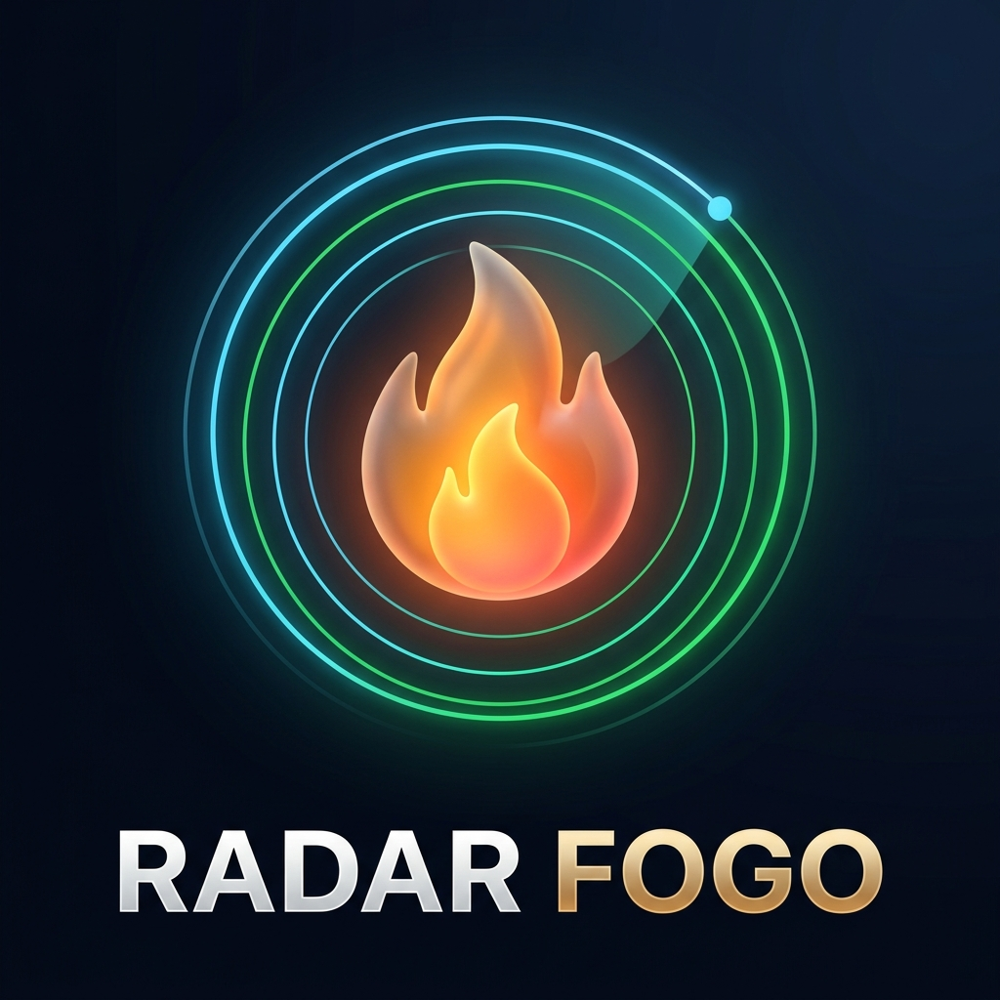

# Radar Fogo — Monitor de Queimadas Acessível (SNCT)

<p align="center">
  
</p>

> **Projeto Institucional:** **IFPI — Campus Floriano** (Instituto Federal do Piauí)  
> **Desenvolvimento:** **Turma TDS-3** (Técnico em Desenvolvimento de Sistemas)  
> **Supervisão e Orientação:** **Prof. Rennê Santos** ([@oxe.renne](https://www.instagram.com/oxe.renne))  
> **Evento:** Semana Nacional de Ciência e Tecnologia (**SNCT / MCTI**)  
> **App Online (Produção Vercel):** [https://radar-fogo-snct.vercel.app](https://radar-fogo-snct.vercel.app)

---

## 1. Visão Geral & Design System (`radar-fogo-ui` • Dark Glass Acessível)

O **Radar Fogo** é um *Progressive Web App* (PWA) construído em **React Native com Expo Router**, projetado sob a estética **Apple iOS 18 Weather (*App Tempo*) Dark Glass** combinada com as regras de **acessibilidade cognitiva para TDAH e TEA Nível de Suporte 1** (Skill `radar-fogo-ui`):

- **Hierarquia previsível em todas as telas:** **Título → Resumo → Detalhes sob demanda** (divulgação progressiva).
- **Risco nunca indicado apenas por cor:** Todos os selos, cartões e legendas combinam **cor + ícone + texto** (`Baixo`, `Médio`, `Alto` e `Crítico`).
- **Temperatura e Focos em Destaque:** O card principal exibe a temperatura regional estimada (`°C`), máxima/mínima, umidade (`%`), focos ativos e barra de risco.
- **Conforto Visual e Movimento Reduzido:** Animações curtas (`150 ms` a `300 ms`), sem loops ou piscas, com detecção automática do sistema e interruptor **"Reduzir animações"** no topo do app e na aba `Sobre o App`.
- **Alvos de toque confortáveis:** Todos os botões, filtros e links possuem área mínima de `44×44 px` e link direto para satélite no **Google Maps**.

### Destaques Visuais e Gráficos com Gradiente:
1. **Card Principal estilo App Tempo (`index.tsx`):** Exibição imediata da temperatura regional (`°C`), contagem de focos ativos, potência radiativa máxima (FRP em MW), barra de nível de risco e filtro rápido para os 9 estados do Nordeste (`MA`, `PI`, `CE`, `RN`, `PB`, `PE`, `AL`, `SE`, `BA`), com destaque para **Floriano (PI)**.
2. **Curva Horária de Potência Radiativa (`FrpOrbitalAreaChart`):** Gráfico vetorial em curva de Bézier cúbica com preenchimento em gradiente térmico (`#FF453A` → `#FF9F0A` → transparente) mapeando as janelas orbitais de 10 a 30 minutos dos satélites `AQUA_M-T`, `NOAA-20`, `GOES-16`, `NPP-SUOMI` e `TERRA`.
3. **Temperatura, Focos e Risco por Estado (`StateThermalRangeBars`):** Lista resumida dos 5 estados mais críticos (expansível para todos os 9 estados do Nordeste) com temperatura (`°C`), focos ativos, cápsula em gradiente térmico e selo acessível (`cor + ícone + texto`).
4. **Bento Grid Ambiental (`BentoEnvironmentalWidgets`):** Medidor de espectro contínuo de Risco de Fogo e distribuição proporcional por bioma (*Caatinga*, *Cerrado MATOPIBA* e *Mata Atlântica*).
5. **Radar Cartográfico Oficial IBGE (`index.tsx`):** Malha vetorial oficial do IBGE para os 9 estados do Nordeste, com nomes das cidades ao clicar nos focos, link direto para o Google Maps e legenda inferior fixa sem sobreposição.

---

## 2. Estrutura Modular do Projeto

```text
/
├── .agent/skills/radar-fogo-ui/SKILL.md # Skill de design acessível (TDAH e TEA nível 1)
├── docs/radar-fogo-ui.md                # Documentação de referência da skill de UI
├── app.json                             # Metadados PWA Dark Glass, ícone e identidade Radar Fogo / IFPI TDS-3
├── package.json                         # Dependências Expo Router, React Native Web e SVG
├── vercel.json                          # Configuração de build e rotas SPA para deploy na Vercel
├── public/
│   ├── logo-radar-fogo.png              # Logo oficial 3D Dark Glass com "RADAR FOGO" em destaque
│   └── preview-snct.html                # Versão standalone para apresentação offline
└── app/
    ├── _layout.tsx                      # Tema Dark Glass (#070C18), botão Reduzir Animações e Créditos IFPI
    ├── theme/
    │   └── tokens.ts                    # Tokens unificados, níveis de risco e estimativa climática (°C)
    ├── components/
    │   └── IosWeatherWidgets.tsx        # Logo vetorial 3D, Curva FRP, Lista de Estados e Bento Grid
    ├── (tabs)/
    │   ├── _layout.tsx                  # Barra de navegação inferior acessível (mín. 48px)
    │   ├── index.tsx                    # Radar Nordeste + Card de Clima e Risco + Mapa IBGE
    │   ├── consulta.tsx                 # Consulta por Estado e Município (API IBGE em <= 3 toques)
    │   └── sobre.tsx                    # Sobre o App, Preferências de Acessibilidade, Fontes e Créditos
    └── services/
        ├── fireDataService.ts           # Integração INPE (10m), CENSIPAM (30m), IBGE e Google Maps
        └── neStatesGeoPaths.ts          # Malha cartográfica oficial do IBGE dos 9 estados do Nordeste
```

---

## 3. Como Executar Localmente

```bash
npm install
npm run web
```
Acesse no navegador: **http://localhost:8081**
